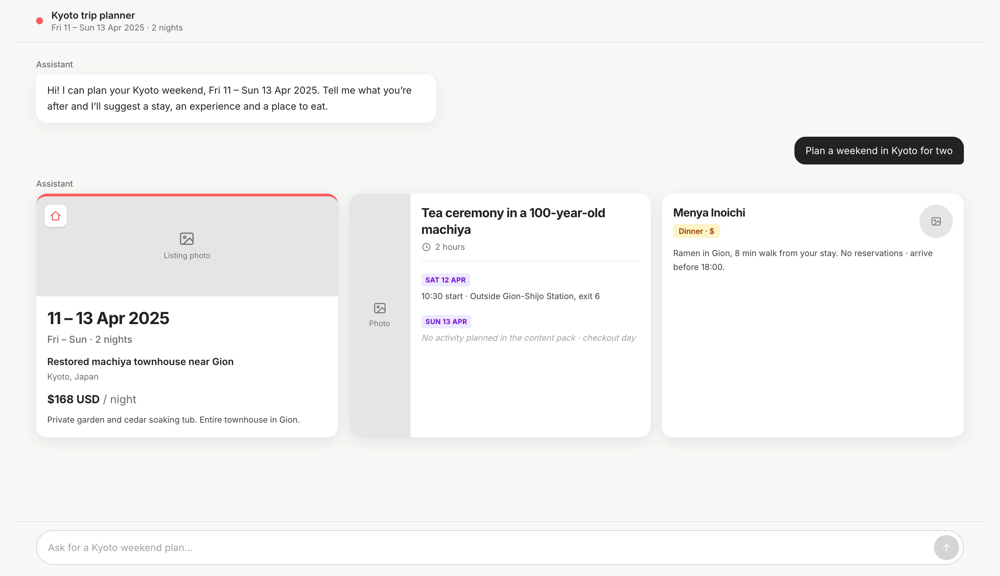

# Kyoto trip planner

A clickable prototype of a trip-planner chat for one two-night weekend in Kyoto (Fri 11 – Sun 13 Apr 2025). Ask the assistant to plan your weekend: it thinks for a moment, then replies with three cards — a stay, an experience and a place to eat.

## What it does

- **Three cards per reply**, in this order: stay, experience, food.
- **Different data every prompt.** Prompt 1 uses row 1 of each sheet in the content pack, prompt 2 uses row 2, and so on, starting again after row 4.
- **Thinking animation** for about 1.4 seconds before each reply. The text box locks while it plays and unlocks when the cards or the error bubble appear; on desktop the cursor goes back into the box.
- **Responsive layout.** On desktop (1024px and wider) the cards sit left to right; on phones they stack top to bottom.
- **Error bubble.** Add `?fail=once` to the address: the first request fails and shows a *Try again* button, which resends the same request.

## Run it

Run `npm install && npm run dev` (Node.js 20 or newer), then open http://localhost:3000.

## Where things are

| File | What it holds |
| --- | --- |
| `src/data/content-pack.ts` | The dummy data, copied from the Kyoto Weekend Prototype Content Pack spreadsheet |
| `src/lib/mock.ts` | Turns a spreadsheet row into the mock response (`cardType` + `details`) |
| `src/app/api/plan/route.ts` | Mock API the chat calls |
| `src/components/cards.tsx` | Stay, experience and food cards, and the error bubble |
| `src/components/TripChat.tsx` | The chat page |

Built with Next.js, TypeScript and Tailwind CSS. The content pack has no photo URLs, so the cards show placeholder image boxes.
